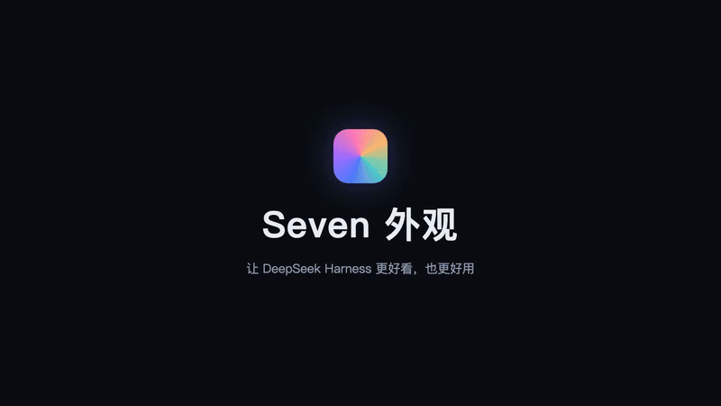
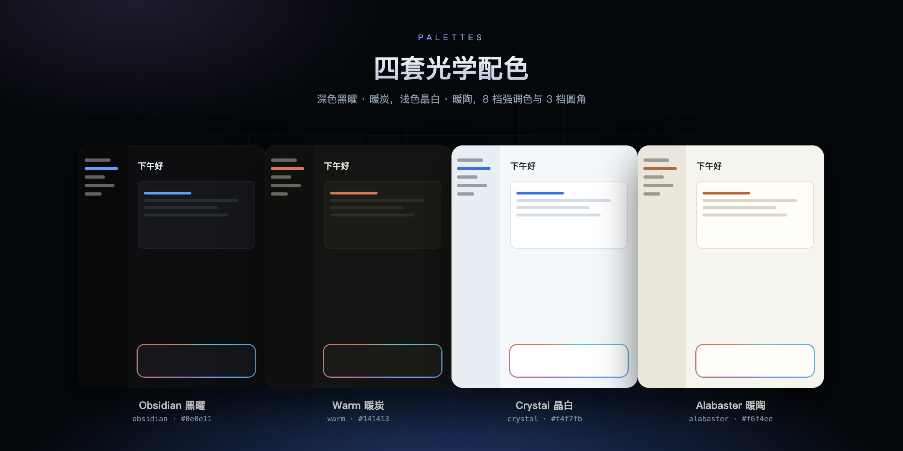
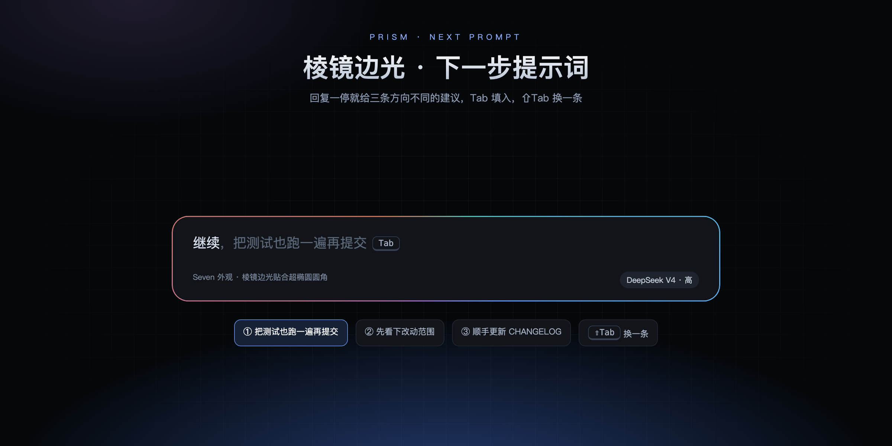
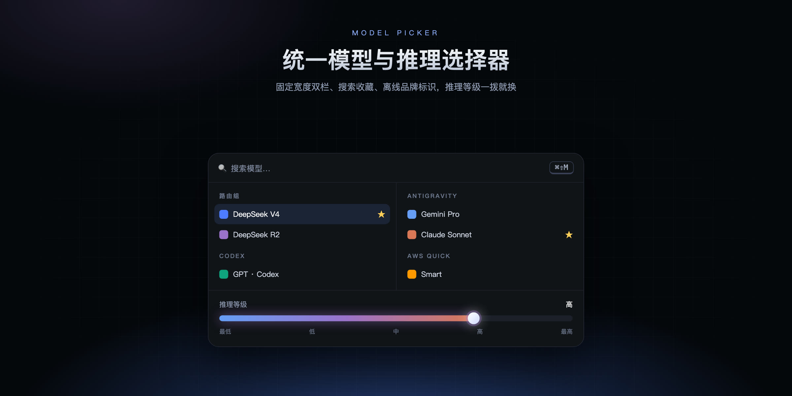
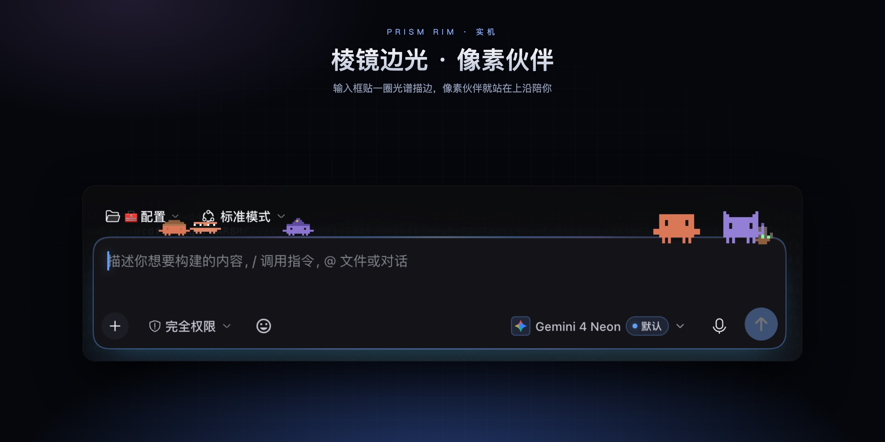
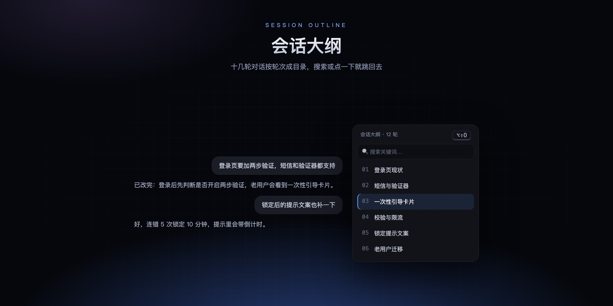
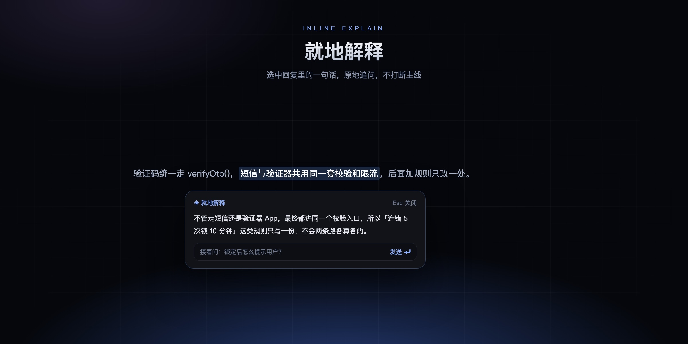
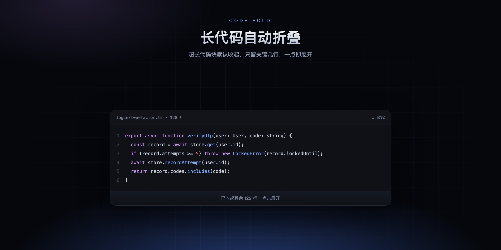

<div align="center">

# Seven Appearance

**A better-looking, more productive DeepSeek Harness**

[](https://www.npmjs.com/package/dsh-seven-appearance)
[](https://github.com/sevenqcx/dsh-seven-appearance/releases)
[](LICENSE)

<a href="docs/promo/seven-appearance-promo.mp4"></a>

<sub>24-second tour · <a href="docs/promo/seven-appearance-promo.mp4">HD MP4</a> · <a href="README.md">中文</a></sub>

| 🎨 4 themes | ✨ Prism glow | 💡 Next-prompt suggestions | 🧭 Unified model picker | 🐳 Pixel mascots |
| :---: | :---: | :---: | :---: | :---: |
| Light & dark | Hugs the composer | `Tab` accept · `⇧Tab` next | `⌘⇧M` search & favorites | Drag to play |

```bash
npm i dsh-seven-appearance
```

</div>

---

## Highlights

- **Four palettes, one click**: Obsidian and Warm Charcoal (dark), Crystal and Alabaster (light), 8 accent colors, 3 corner radii, one-click restore to the native look.
- **Prism glow**: an animated rim that follows the composer's real outline and superellipse corners, spinning while a reply streams.
- **Next-prompt suggestions**: three divergent candidates the moment a reply stops; `Tab` to accept, `⇧Tab` for the next one; learns from your own phrasing.
- **Unified model picker**: fixed-width two-column layout, search and favorites, offline provider logos, `⌘⇧M` to open, reasoning effort on a slider.
- **Pixel companions**: Clawd, a cat, mini crabs and Deepy the pixel whale live above the composer; drag them around.
- **A smoother workbench**: selection explanations, conversation right-click menu, outline navigation, long code block folding, local image/video wallpapers.

---

## Preview

### 1. Four optical palettes

<p align="center"></p>

| Theme | Key | Canvas | Notes |
| :--- | :--- | :--- | :--- |
| **Obsidian** | `obsidian` | `#0E0E11` | Cool cobalt, high-contrast code reading |
| **Warm Charcoal** | `warm` | `#141413` | Warm charcoal and terracotta, low blue light |
| **Crystal** | `crystal` | `#F4F7FB` | Clear porcelain white, cool light theme |
| **Alabaster** | `alabaster` | `#F6F4EE` | Soft paper white, gentle contrast |

### 2. Prism glow · next-prompt suggestions

<p align="center"></p>

### 3. Unified model & reasoning picker

<p align="center"></p>

### 4. Pixel companions

<p align="center"></p>

### 5. Session outline

<p align="center"></p>

### 6. Inline explain

<p align="center"></p>

### 7. Long code folding

<p align="center"></p>

<sub>Rendered mockups using the plugin's real palettes and effects; sample content is fictional.</sub>

---

## Shortcuts

| Shortcut | Action |
| :--- | :--- |
| `Alt+Shift+P` | Open the appearance drawer |
| `⌘⇧M` | Open the model picker |
| `Alt+Shift+O` | Toggle the conversation outline |
| `Tab` / `⇧Tab` | Accept / cycle a prompt suggestion |

---

## Release notes

- **1.1.0** — Three divergent suggestions per batch with instant `⇧Tab` / `↻` cycling; suggestions written in your own voice and priorities; speech-sample learning; accept-rate and latency metrics; zero-latency pure-local mode.
- **1.0.0** — Renamed to Seven Appearance and published as `dsh-seven-appearance`; conversation right-click menu; inline ghost-text next-prompt suggestions; prism rim now hugs superellipse corners and keeps pills perfectly round.
- **0.4.0** — Unified fixed-width model picker (search, favorites, `⌘⇧M`), reasoning-effort slider with cut-crystal effects, offline provider logos, Magpie model grouping.
- **0.3.0** — Selection actions, outline search, conversation animations, composer effects, Chinese/English selector.

<details>
<summary><strong>Overview and details (click to expand)</strong></summary>

## Overview (`dsh-seven-appearance`)

A GPL-3.0-only DeepSeek Harness adaptation of [Obsidian Prism](https://github.com/RMvdesi/obsidian-prism), providing theme palettes, visual effects, mascots, local wallpapers, unified model & reasoning effort picker, next-prompt suggestions (three divergent candidates, speech-sample learning, accept-rate metrics), conversation navigation, and in-place selection explanations from the conversation right-click menu.

Open the settings section named Seven Appearance, or use Alt+Shift+P to open the appearance drawer. Alt+Shift+O toggles the conversation outline. Settings can be exported and imported; wallpaper files are not included in the backup.

Version 0.3.0 adds selection actions, outline search, conversation animations, composer effects, and a Chinese/English selector.

Version 0.4.0 adds a unified fixed-width model picker (search, favorites, Cmd+Shift+M), a reasoning-effort slider with cut-crystal effects that follows the selected model, offline provider logos, and Magpie model grouping (Router, Codex, Antigravity, AWS Quick).

Run `npm test` and `npm run check` to check the package. See LICENSE, NOTICE and THIRD_PARTY_NOTICES.md for license and attribution.

</details>
