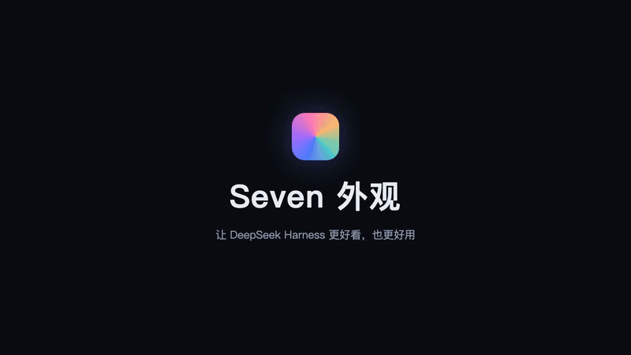
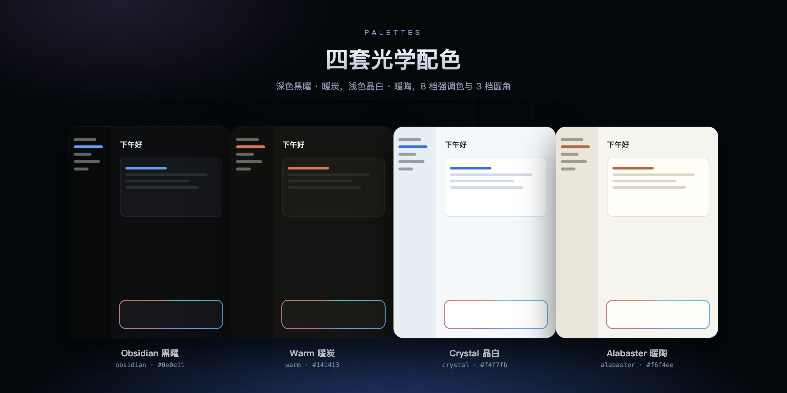
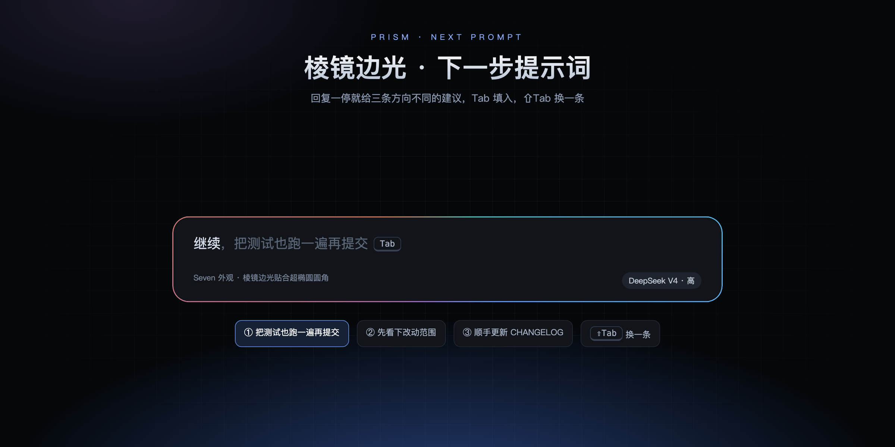
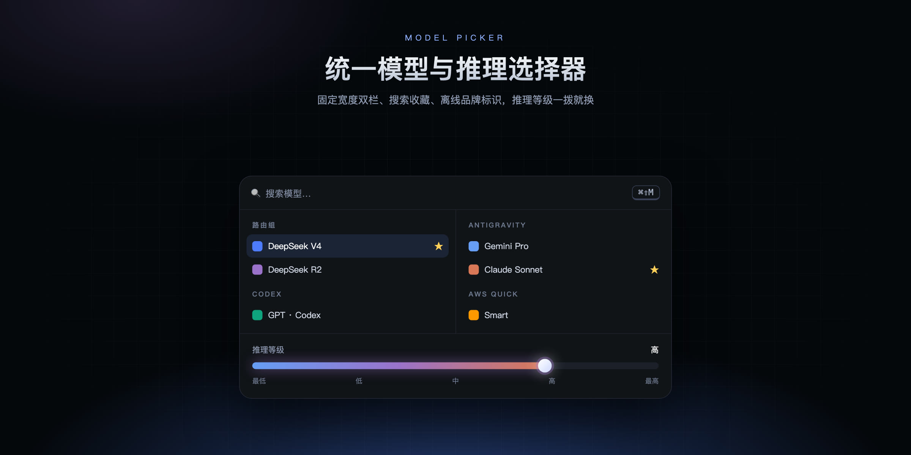
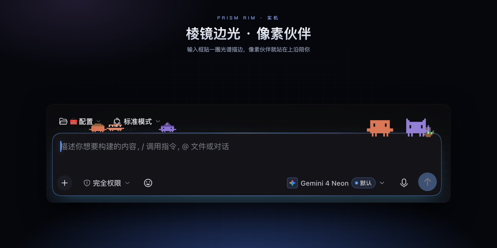
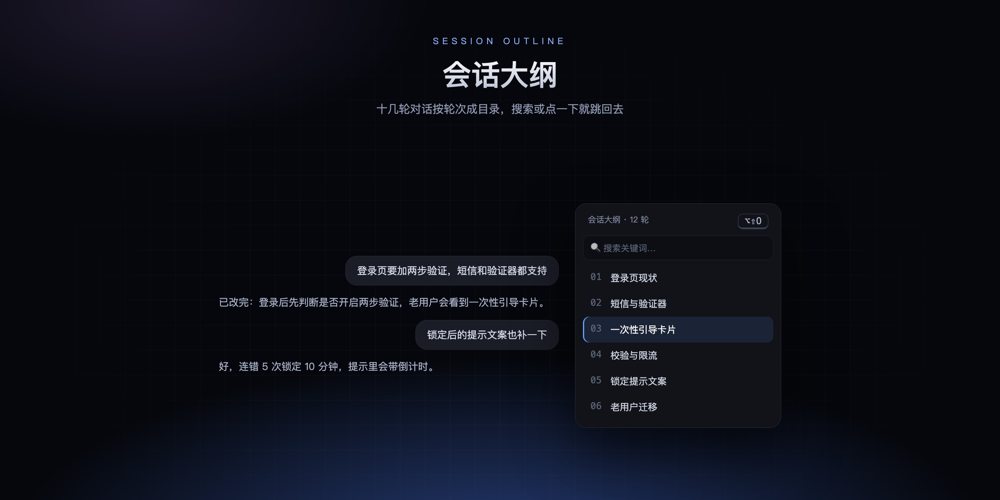
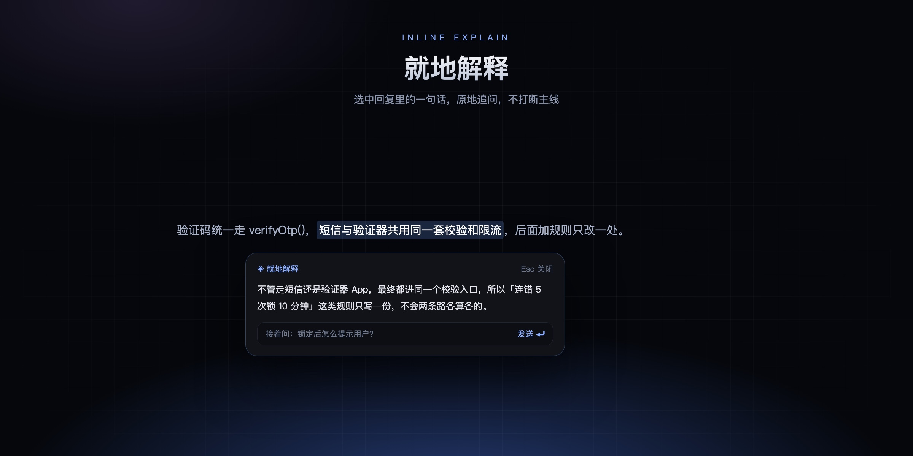
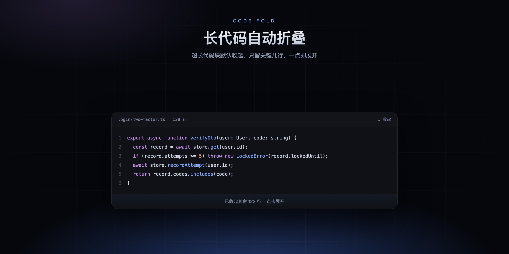

<div align="center">

# Seven 外观

**让 DeepSeek Harness 更好看，也更好用**

[](https://www.npmjs.com/package/dsh-seven-appearance)
[](https://github.com/sevenqcx/dsh-seven-appearance/releases)
[](LICENSE)

<a href="docs/promo/seven-appearance-promo.mp4"></a>

<sub>24 秒速览 · <a href="docs/promo/seven-appearance-promo.mp4">高清 MP4</a> · <a href="README.en.md">English</a></sub>

| 🎨 四套深浅主题 | ✨ 棱镜边光 | 💡 下一步提示词推荐 | 🧭 统一模型选择器 | 🐳 像素伙伴 |
| :---: | :---: | :---: | :---: | :---: |
| 一键切换配色 | 贴合输入框轮廓 | `Tab` 填入 · `⇧Tab` 换一条 | `⌘⇧M` 搜索收藏 | 拖拽互动 |

```bash
npm i dsh-seven-appearance
```

</div>

---

## 亮点

- **四套配色，一键换装**：深色黑曜、暖炭，浅色晶白、暖陶，8 档强调色、3 档圆角，可一键还原原生外观。
- **棱镜边光**：流光描边贴合输入框真实轮廓和超椭圆圆角，生成中跑马灯旋转。
- **下一步提示词**：回复一停就给三条方向不同的建议，`Tab` 填入，`⇧Tab` 换一条，越用越像你说话。
- **统一模型选择器**：固定宽度双栏、搜索收藏、离线品牌标识，`⌘⇧M` 唤出，推理等级一拨就换。
- **像素伙伴舞台**：Clawd、小猫、迷你蟹与 Deepy 像素鲸鱼住在输入框上沿，可拖拽，会陪你干活。
- **更顺手的工作台**：划词解释、对话区右键菜单、会话大纲、长代码块折叠、本地动静态壁纸。

---

## 界面预览

### 1. 四套光学配色

<p align="center"></p>

| 主题 | 配置键 | 主画布 | 说明 |
| :--- | :--- | :--- | :--- |
| **Obsidian 黑曜** | `obsidian` | `#0E0E11` | 冷曜钴蓝，高对比代码阅读 |
| **Warm 暖炭** | `warm` | `#141413` | 沉稳暖炭陶橙，低蓝光夜间 |
| **Crystal 晶白** | `crystal` | `#F4F7FB` | 清透瓷白，冷调浅色 |
| **Alabaster 暖陶** | `alabaster` | `#F6F4EE` | 温润纸白，柔和对比 |

### 2. 棱镜边光 · 下一步提示词

<p align="center"></p>

### 3. 统一模型与推理选择器

<p align="center"></p>

### 4. 像素伙伴舞台

<p align="center"></p>

### 5. 会话大纲

<p align="center"></p>

### 6. 就地解释

<p align="center"></p>

### 7. 长代码自动折叠

<p align="center"></p>

<sub>以上画面按插件真实配色与光效仿制渲染，示例内容为虚构。</sub>

---

## 快捷键

| 快捷键 | 作用 |
| :--- | :--- |
| `Alt+Shift+P` | 打开外观工坊抽屉 |
| `⌘⇧M` | 打开模型选择器 |
| `Alt+Shift+O` | 开关会话大纲 |
| `Tab` / `⇧Tab` | 填入 / 换一条提示词建议 |

---

<details>
<summary><strong>完整更新记录与功能细节（点击展开）</strong></summary>

## 简介 (`dsh-seven-appearance`)

基于 [RMvdesi/obsidian-prism](https://github.com/RMvdesi/obsidian-prism)（GPL-3.0-only）深度移植与定制的 DeepSeek Harness 外观与效率增强插件，涵盖主题配色、棱镜光效、像素伙伴舞台、本地动静态壁纸、统一模型与推理选择器、下一步提示词推荐、划词就地解释及会话工作台增强。

## 功能

### v1.1.0

- 下一步提示词推荐每次给三条方向不同的候选，`Shift+Tab` 或 `↻` 瞬间切换，看完一批才取新的。
- 建议按使用者本人口吻和关注点（效果、进度、花费、风险）来写，并按场景排第一行。
- 说话样本学习：记住你真实发过的短句作为参考，越用越像你自己会说的话。
- 效果统计：记录出现、采纳、换一条、放弃与出现延迟，可查采纳率和延迟。
- 助手把动作交回给你时按「早做完了」来写；去掉本地占位再被模型覆盖的两段式，纯本地模式仍零延迟。

### v1.0.0

- 正式更名为 **Seven 外观（Seven Appearance）** 并发布公开插件包 `dsh-seven-appearance`。
- 新增对话区右键菜单（与划词解释统一开关，按住 Shift 保留系统菜单）。
- 新增下一步提示词推荐：空输入框内联半透明幽灵文字，回复停住瞬间出建议（支持纯本地模式、`Tab` 填入、`Shift+Tab` 换候选）。
- 修复棱镜流光边框与超椭圆圆角贴合与正圆/胶囊保形。

### v0.4.0

- 统一模型选择器：固定宽度、免翻页双栏、搜索与收藏、快捷键 `⌘⇧M`，适配 4 套主题。
- 推理等级滑块 + 切工水晶光效，档位跟随当前模型。
- 离线品牌 Logo 与 Magpie 逻辑分组（路由组 → Codex → Antigravity → AWS Quick）。
- 单击模型切换不关弹窗，双击或点外部关闭。

### v0.3.0

- 划选会话文字后，可引用、生成解释请求或复制；引用会填入输入框，发送前可继续编辑。
- 会话大纲增加搜索与分类；支持收起、固定和快捷键 `Alt+Shift+O`。
- 增加输入框棱镜光效、状态指示、回复动画和中英文切换。

## 原有功能

### Batch 2（v0.2.0 — 方向 A 视觉打磨）

1. **空会话主页 & 对话页 WebGL2 ASCII 矩阵涟漪与地平线光晕**
   - 完整集成 `vendor/ripple-core.js` WebGL2/2D 双栈引擎，挂载于 DSH 空会话 `[data-phase="hero"]` 与可选对话流 `[data-phase="active"]`
   - 鼠标滑过产生星云光晕与矩阵字符波动，点击触发扩散波纹，品牌标题区自动避让（Calm Zone）；静止时停止动画，后台页面清理画布，失焦时进入休眠；启用壁纸或流式回复时自动让位
2. **Smoked Obsidian 黑曜切面质感统一**
   - 覆盖用户消息气泡 `[data-message-bubble]`、工具调用与思考折叠块 `[data-tool]` / `[data-chat-group-part="reasoning"]`、交付物与 Diff 审查卡片 `[data-presented-file]` / `[data-changed-files]` / `[data-changes-review]`、内联路径芯片与立体 `kbd` 键帽
   - 4 套深浅主题（Obsidian / Warm / Crystal / Alabaster）均独立校准高光切面与 Diff 边条色板，可随时通过「黑曜切面质感统一」总开关一键还原
3. **场景预设 & 配置 JSON 导入/导出**
   - 内置三档场景预设：**完整光效**（Full Prism）、**专注编码**（Focus Code）、**静默省电**（Quiet Eco），切换时保留当前明暗调色板与本地壁纸
   - 支持导出 `obsidian-prism-config.json` 与导入恢复（导出自动剥离本机壁纸绑定，导入时自动保留目标机器现有本地壁纸）

### Batch 1（v0.1.0 基础套件）

1. **四套精选深浅主题 & 强调色系统**
   - 深色：`Obsidian 黑曜`（冷曜钴蓝）、`Warm Charcoal 暖炭`（沉稳暖炭陶橙）
   - 浅色：`Crystal 晶白`（清透瓷白）、`Alabaster 暖陶`（温润纸白）
   - 8 档强调色（跟随主题 / 棱镜 / 钴蓝 / 暖陶 / 翠绿 / 紫晶 / 琥珀 / 玫瑰）、3 档界面圆角、5 款等宽代码字体
   - 映射至 DSH 原生 `--dsw-alias-*` / `--dsw-specific-*` CSS 变量，自动跟随 DSH `data-ds-dark-theme`，支持一键总开关还原原生外观
2. **棱镜微光、流式淡入与丝滑光标**
   - 输入框棱镜光环（`@property` 旋转棱镜描边，聚焦/流式生成时动态提亮）与柔和环境氛围光晕
   - 流式回复文字淡入（基于 CSS Custom Highlight API，零 DOM 侵入）
   - 输入框丝滑弹簧光标（支持 `<textarea>` 与 `contenteditable`）
3. **可交互像素伙伴舞台（含 Deepy 像素鲸鱼）**
   - 完整集成 `dual-mascot-rig.js` 像素物理引擎，驻留于 `[data-composer-card]` 上沿
   - 支持拖拽、点击互动、流式生成工作态，预设涵盖双宠（Clawd + Cat）、迷你蟹群、四宠（含 Deepy 鲸鱼 & 像素龙）以及单宠模式
4. **本地自定义图片 / 视频壁纸服务**
   - Host 端 HTTP 接口存储于 `~/.dsh/obsidian-prism/wallpapers/`，支持 PNG/JPG/WebP/GIF/AVIF/MP4/WebM/MOV（最大 80MB）
   - 视频流支持标准 HTTP `Range` (`206 Partial Content`) 播放，切后台自动暂停省电；提供不透明度、模糊度、卡片磨砂透底调节
5. **会话工作台增强**
   - 长代码块自动折叠 + 吸顶语言/行数操作栏（可自定义行数阈值）
   - 右侧悬浮会话大纲导航（超过 2 轮提问自动出现，悬停预览、点击平滑跳转）
6. **双入口实时外观工坊**
   - 原生注册到 DSH **设置 → Seven 外观** 独立分区
   - 右下角轻巧快捷入口按钮 + 全局快捷键 `Alt+Shift+P` 随时唤出侧滑抽屉，设置持久化至 `~/.dsh/obsidian-prism/settings.json`

</details>

## 构建与测试

```bash
npm run build   # 打包 vendor/dual-mascot-rig.js + src/*.js -> client.js
npm run check   # 校验 index.js 与 client.js 语法
npm test        # 构建并运行全部单元测试
```

## 开源协议与致谢

本插件遵循 **GNU General Public License v3.0 (GPL-3.0-only)**，详见 `LICENSE`、`NOTICE` 与 `THIRD_PARTY_NOTICES.md`。
